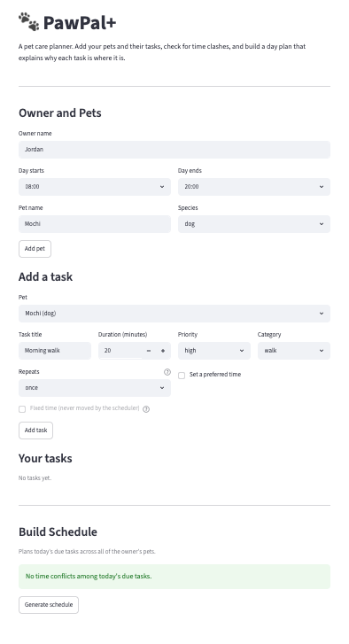
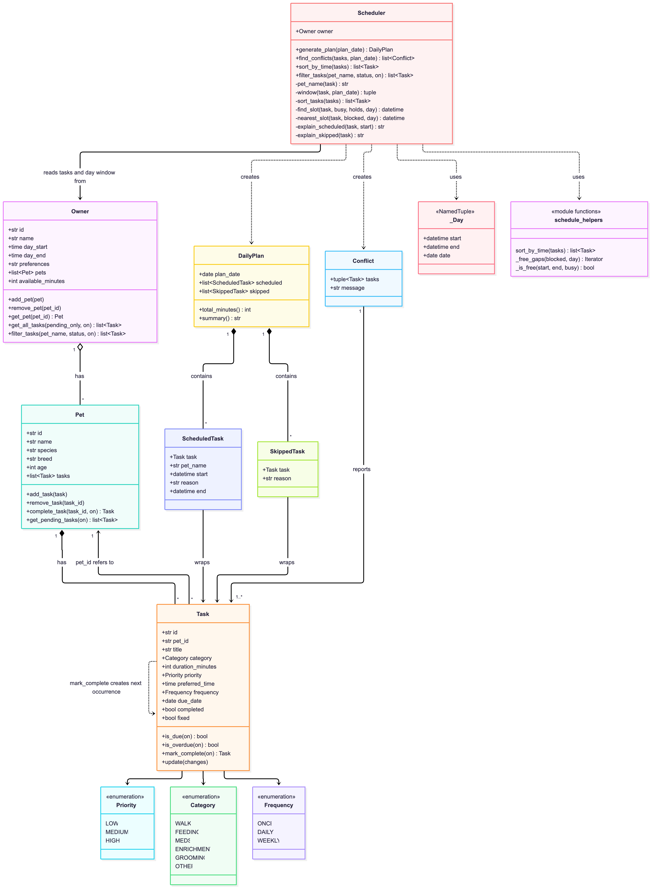

# PawPal+ (Module 2 Project)

You are building **PawPal+**, a Streamlit app that helps a pet owner plan care tasks for their pet.

## Scenario

A busy pet owner needs help staying consistent with pet care. They want an assistant that can:

- Track pet care tasks (walks, feeding, meds, enrichment, grooming, etc.)
- Consider constraints (time available, priority, owner preferences)
- Produce a daily plan and explain why it chose that plan

Your job is to design the system first (UML), then implement the logic in Python, then connect it to the Streamlit UI.

## What you will build

Your final app should:

- Let a user enter basic owner + pet info
- Let a user add/edit tasks (duration + priority at minimum)
- Generate a daily schedule/plan based on constraints and priorities
- Display the plan clearly (and ideally explain the reasoning)
- Include tests for the most important scheduling behaviors

## Implementation summary

The core logic lives in [pawpal_system.py](pawpal_system.py) and follows the diagram in [diagrams/uml_final.mmd](diagrams/uml_final.mmd). It runs from the terminal with `python main.py`.

How the classes work together:

- An **Owner** has one or more **Pets** and a daily availability window (for example 08:00 to 12:00).
- Each **Pet** keeps its own list of **Tasks**: a walk, a feeding, a medication. A task has a duration, a priority, an optional preferred time, and can repeat daily or weekly.
- The **Scheduler** takes an owner and asks it for every pet's due tasks in one call (`owner.get_all_tasks`), so it plans for the whole household.
- It sorts those tasks by priority, then tries to give each one its preferred time, falling back to the nearest free slot in the owner's window. Tasks that don't fit are skipped.
- The result is a **DailyPlan**: the scheduled tasks (each with a start and end time and a plain-English reason) and the skipped tasks with the reason they were left out.

The approach is greedy, so it is simple and easy to explain, but not optimal: a long high-priority task can use up time that several short ones needed.

Tests for the core classes and the scheduling features below are in [tests/test_pawpal.py](tests/test_pawpal.py).

## ✨ Features

**Planning**

- **Priority-based daily plan.** Tasks from all of an owner's pets are planned together inside the owner's day window. Order: fixed tasks first, then high to low priority, then earlier preferred time, then shorter duration, then title, so the same input always gives the same plan.
- **Preferred times with nearest-slot fallback.** A task goes at its preferred time when that time is free. If not, it goes to the free slot nearest to the preferred time, before or after. A task with no preferred time takes the earliest free slot.
- **Fixed tasks.** A task marked fixed (such as medication) is placed first at its exact time and is never moved. If two fixed tasks overlap, or one falls outside the day, the later one is skipped and reported.
- **Soft holds.** A task with no preferred time avoids the preferred windows of tasks not yet placed, when it can, so it does not block them.
- **Skipped tasks with reasons.** A task that does not fit is listed with why, not dropped silently.
- **Plain-English explanations.** Every scheduled task says why it is where it is: placed at its preferred time, or the preferred time was unavailable.
- **Next available slot.** Ask for the earliest free time for a task of a given length, optionally starting from a chosen time. The search runs on the real plan, so it already accounts for every due task and for tasks that were moved. A task placed at the suggested time does not move anything else. If nothing fits before the end of the day, it says so. In the app this is the **Suggest a free time** button.
- **No overlaps, inside the day.** A plan never double-books the owner and never goes outside the owner's available window. A randomized test checks this over 200 plans.

**Organizing tasks**

- **Sorting by time.** Tasks are ordered by preferred time, untimed last, with ties broken by priority and then title.
- **Filtering.** Filter by pet name (case-insensitive) and by status: pending, overdue or completed. Filtering and sorting can be combined.
- **Due-date awareness.** Only tasks that are not completed and due on or before the plan date are planned. Overdue tasks are included. Tasks due in the future are left out.

**Warnings**

- **Conflict warnings.** The scheduler flags tasks whose preferred times overlap, including two tasks at exactly the same time, and including tasks for different pets, because the owner is one person. It also flags a task whose preferred window falls outside the owner's day. Tasks that only touch (one ends at 10:00, the next starts at 10:00) are not conflicts. In the app, each warning says which task keeps its time and which one moves.

**Recurring tasks**

- **Daily and weekly recurrence.** Completing a daily or weekly task creates the next copy, due 1 or 7 days later. If the task was overdue, the date counts from the completion date, so it does not stay overdue. If it was completed early, the original schedule is kept. Completing a task twice never creates a duplicate, and a one-time task creates none.

**Data safety**

- **Saved between runs.** Pets, tasks and the owner's settings are saved to `data.json` and loaded again at the next start, so nothing is lost when the app closes. See [Saving your data](#-saving-your-data).
- **Validation.** Empty titles, non-positive durations, and a fixed task with no preferred time are rejected. Duplicate task or pet ids are rejected, and looking up a missing id raises an error.
- **Safe edits.** `Task.update` changes several fields at once. If any value is invalid, every field is rolled back. `id` and `pet_id` cannot be changed.

**App (Streamlit)**

- Add pets and tasks (duration, priority, category, repeat, preferred time, fixed) and set the owner's day window.
- A sorted, filterable task table with a "done" button for each pending task.
- Conflict warnings when a task is added and above the schedule button, then a schedule table with the reasons and a list of skipped tasks.

Details of the algorithms are in [Smarter Scheduling](#-smarter-scheduling) below.

## Getting started

### Setup

```bash
python -m venv .venv
source .venv/bin/activate  # Windows: .venv\Scripts\activate
pip install -r requirements.txt
```

### Run the app

```bash
streamlit run app.py   # the web app
python main.py         # a terminal demo with sample pets and tasks
```

### Suggested workflow

1. Read the scenario carefully and identify requirements and edge cases.
2. Draft a UML diagram (classes, attributes, methods, relationships).
3. Convert UML into Python class stubs (no logic yet).
4. Implement scheduling logic in small increments.
5. Add tests to verify key behaviors.
6. Connect your logic to the Streamlit UI in `app.py`.
7. Refine UML so it matches what you actually built.

## 🖥️ Sample Output

Output of `python main.py`, which builds one owner with two pets (Rex the dog and Mia the cat) and six tasks, then prints the schedule for today:

```
Today's Schedule for Sam (Friday, October 16)
Available: 08:00-12:00 (240 min), scheduled: 110 min
------------------------------------------------------------
08:00-08:10  Breakfast            Mia   [high]
             high priority; placed at its preferred time
08:30-09:15  Morning walk         Rex   [high]
             high priority; placed at its preferred time
09:30-09:35  Medication           Mia   [high]
             high priority; placed at its preferred time
09:35-10:05  Laser pointer play   Mia   [medium]
             medium priority; preferred time 09:30 was unavailable
11:00-11:20  Brush coat           Rex   [low]
             low priority; placed at its preferred time

Skipped:
  Clean litter box: low priority, but no free 180-minute slot left between 08:00 and 12:00
```

## 🧪 Testing PawPal+

Run the full suite from the project root:

```bash
pytest
```

**What the 118 tests in [tests/test_pawpal.py](tests/test_pawpal.py) cover:**

- **Sorting:** chronological order, untimed tasks last, deterministic tie-breaking by priority then title.
- **Recurrence:** completing a daily or weekly task creates one new copy due the next day or week. This includes overdue and early completion, leap days and year ends. `ONCE` tasks create none.
- **Conflict detection:** overlapping windows, two tasks at the exact same time, conflicts across pets, windows outside the owner's day. Untimed, completed and not-yet-due tasks are ignored.
- **Plan generation:** only due tasks are planned, priority wins a clash, the loser goes to the nearest free slot, and fixed tasks never move. Tasks that do not fit are skipped with a reason. A randomized test checks 200 plans for overlaps and day-window violations.
- **Edge cases:** a pet with no tasks, an owner with no pets, tasks ending exactly at the end of the day, a day window too small for any task, and the greedy limit where one long task crowds out short ones.
- **Next available slot:** an empty day, gaps between tasks, an exact fit, a slot ending exactly at the end of the day, no free slot, a search start time, moved tasks counted, completed and future tasks ignored, and a new task at the suggested time moving nothing.
- **Saving and loading:** a full round trip with every field type, ids and the pet link kept, the same plan before and after, recurrence still working after a load, a missing file, garbage and invalid data (fifteen kinds), and a failed load leaving the file untouched.
- **Bad input:** empty titles, non-positive durations, duplicate or missing ids, and `Task.update` rolling back on invalid or protected fields.

Sample test output:

```
================================================================== test session starts ==================================================================
platform darwin -- Python 3.14.6, pytest-9.0.3, pluggy-1.6.0
rootdir: /Users/vvirtonen/GitHub/ai110/ai110-module2show-pawpal-starter
configfile: pytest.ini
testpaths: tests
plugins: anyio-4.12.1
collected 118 items                                                                                                                                      

tests/test_pawpal.py .........................................................................                                                    [100%]

================================================================== 118 passed in 0.07s ===================================================================
```

**Confidence level: ⭐⭐⭐⭐ (4 / 5)**

All 118 tests pass, and they cover the core behaviors where a bug would hurt the owner most: no overlapping plans, correct recurrence dates, and rejected bad input. I trust the scheduling logic and the data model. I stop at 4/5 because:

- The scheduler is greedy, so it is not optimal. One long high-priority task can crowd out several short ones (a test documents this).
- Tests cover `pawpal_system.py` only. The Streamlit UI in `app.py` has no automated tests.
- Times are plain local times, with no time zones, daylight saving or tasks that run past midnight.
- Coverage has not been measured.

## 💾 Saving your data

The app remembers your owner, pets and tasks between runs in a file called `data.json`, next to `app.py`.

**How it works**

1. **Start.** The app loads `data.json` if it exists. If not, it starts empty.
2. **Every change is saved straight away:** adding a pet or task, marking a task done, changing the owner's name or day hours.
3. **Next start.** Everything is back, including completed tasks and the next copy of a recurring one. The schedule itself is not saved, because it is rebuilt from the tasks each time.
4. **Damaged file.** If `data.json` cannot be read, the app keeps it as `data.json.corrupt`, shows a warning and starts empty, so a bad file never crashes the app or is silently overwritten.

To start over, delete `data.json`.

**In code** (on `Owner`, in [pawpal_system.py](pawpal_system.py)):

```python
owner.save_to_json("data.json")             # writes owner, pets and tasks
owner = Owner.load_from_json("data.json")   # FileNotFoundError if there is no file,
                                            # ValueError if it is invalid
```

Each class has `to_dict()` and `from_dict()` that turn objects into plain JSON values and back: enums are saved by name or value, times and dates as ISO text, and ids are kept so each task still points to its pet. Loading re-runs the normal validation, so bad data is rejected with a `ValueError`. Saving writes a temporary file first and then moves it into place, so a crash cannot leave half a file.

**Files changed:** `pawpal_system.py` (`to_dict`/`from_dict` on `Task`, `Pet`, `Owner`; `Owner.save_to_json`/`load_from_json`), `app.py` (load at start, save after changes), `tests/test_pawpal.py` (32 new tests), `.gitignore` (data files are not committed), `diagrams/uml_final.mmd` and this README. `main.py` is unchanged; it builds its own sample data.

## 📐 Smarter Scheduling

| Feature | Method(s) | Notes |
|---------|-----------|-------|
| Sorting | `Scheduler.sort_by_time()`, `sort_by_time()` | By preferred time, untimed last, then priority |
| Filtering | `Scheduler.filter_tasks()`, `Owner.filter_tasks()` | By pet name and/or status |
| Conflict detection | `Scheduler.find_conflicts()` | Overlapping windows; returns warnings |
| Recurring tasks | `Task.mark_complete()`, `Pet.complete_task()` | Daily and weekly; creates the next occurrence |
| Slot placement | `Scheduler.generate_plan()`, `_find_slot()` | Nearest free slot; fixed tasks never move |
| Next available slot | `Scheduler.next_available_slot()` | Earliest free gap of a given length in the real plan |

**Sorting.** `Scheduler.sort_by_time(tasks=None)` returns tasks ordered by `preferred_time`. Tasks without one go last. Ties are broken by priority (high first), then title. With no argument it sorts all pending tasks.

**Filtering.** `Scheduler.filter_tasks(pet_name, status, on)` returns tasks for one pet (case-insensitive) and/or one status: `"pending"` (not completed and due on `on`), `"completed"`, or `"overdue"` (not completed, due before `on`). Both filters can be combined, and an unknown status raises `ValueError`. Sorting and filtering compose: `scheduler.sort_by_time(scheduler.filter_tasks("Mia", "pending"))`.

**Conflict detection.** `Scheduler.find_conflicts()` is a lightweight check: it returns a list of `Conflict` objects with a readable `message` and never raises. It compares each task's preferred window (start plus duration), across pets as well as within one pet, because the owner is one person. It sorts by start time and sweeps once, comparing each task with the window that ends latest so far (O(n log n)). It also flags a window outside the owner's day. Tasks that only touch, such as one ending at 10:00 and another starting at 10:00, are not conflicts. `generate_plan()` still resolves the clash by moving the lower-priority task, so the warning tells the owner what moved. The Streamlit app shows these warnings when a task is added and above the schedule button.

**Recurring tasks.** `Task.mark_complete(on=None)` marks a task done. For a `DAILY` or `WEEKLY` task it returns a new copy with a new id, not completed, and due 1 or 7 days after the later of the old due date and the completion date. `Pet.complete_task()` adds that copy to the pet. Completing a task twice does not create a second copy, and a `ONCE` task creates none.

**Slot placement.** `generate_plan()` places `fixed` tasks first at their exact time, then the rest by priority. A task that cannot have its preferred time goes to the free slot nearest to it. Tasks with no preference avoid other tasks' preferred windows when they can. Tasks that do not fit are skipped with a reason (`DailyPlan.skipped` holds `SkippedTask(task, reason)`).

**Next available slot.** `Scheduler.next_available_slot(duration_minutes, plan_date=None, after=None)` answers "when can I fit a task of this length without disturbing anything?" It builds the plan `generate_plan()` would build for that date, treats the scheduled tasks as busy, and walks the free gaps in order, returning the first start at or after `after` (default: the start of the owner's day) with room for the duration. A slot may end exactly at `day_end`. It returns `None` when nothing fits, and raises `ValueError` for a non-positive duration. It reads the plan only, so it changes no task. Because it uses the real plan, a slot it returns is one where a new task, given that time, is placed there and no existing task is moved. The app's **Suggest a free time** button uses it.

## 📸 Demo Walkthrough

### The app at a glance

Start it with `streamlit run app.py`. This is the app on first launch, with one pet added and no tasks yet:



The page has three parts, top to bottom:

1. **Owner and Pets.** Enter the owner's name and the hours they are available (**Day starts** / **Day ends**). Type a pet name, pick a species and press **Add pet**. You can add as many pets as you like. If the end time is not after the start time, the app shows an error and keeps the previous hours.
2. **Add a task and Your tasks.**
   - Choose a pet, then set the title, duration, priority, category, how often it **Repeats** (once, daily, weekly) and, optionally, a **preferred time**. Tick **Fixed time** for things that must not move, such as medication. Press **Add task**. Press **Suggest a free time** first if you want the app to find the earliest slot that fits the duration without moving any other task.
   - The task table can be filtered by pet and by status (all, pending, overdue, completed). It is always sorted by preferred time, with tasks that have no time last.
   - Each pending task has a **✓ done** button. Completing a daily or weekly task shows when the next one is due.
3. **Build Schedule.** Time conflicts are listed first. **Generate schedule** then builds today's plan: a table of start and end times, the pet, the priority, and a **why** column, followed by any tasks that did not fit.

### Example workflow

1. **Add a pet.** Leave the owner at 08:00-20:00, type "Mochi", choose "dog" and press **Add pet**.
2. **Add a first task.** Title "Morning walk", 20 minutes, priority high, **Repeats** daily, tick **Set a preferred time** and leave it at 09:00. Press **Add task**. A green message confirms it.
3. **Add a clashing task.** Title "Feed", 20 minutes, priority low, preferred time 09:00. When you press **Add task**, a warning appears at once: *"Both want 09:00: **Morning walk** (Mochi) keeps 09:00; **Feed** (Mochi) moves to 08:40."*
4. **Check your tasks.** Under **Your tasks**, both tasks show at 09:00, sorted by time. Use **Show status** to switch between pending and completed.
5. **Build the plan.** Under **Build Schedule**, a yellow banner says "1 time clash found. Nothing is lost…" and repeats the line from step 3. Press **Generate schedule**. The table shows Feed at 08:40-09:00 and Morning walk at 09:00-09:20, each with a reason such as "preferred time 09:00 was unavailable" or "placed at its preferred time".
6. **Mark it done.** Press **✓ Morning walk (Mochi)**. The app says the next walk is due tomorrow. The task table now shows today's walk as done and a new copy as due tomorrow. The clash is gone from the warnings, because the completed walk is no longer due today.

### Scheduler behaviors on show

| Behavior | Where you see it |
|----------|------------------|
| **Sorting by time** | The task table and the "Sorted by time" lists in the terminal output below. Untimed tasks are last, and ties go to the higher priority. |
| **Filtering** | The pet and status selectors in the app. In the terminal output: "Mia's tasks, sorted" and "Rex, pending today, sorted". |
| **Conflict warnings** | A warning when a task is added, a banner above **Generate schedule**, and the "Conflict check" lines below. Conflicts across different pets are caught too (Mia's laser play against Rex's training). |
| **Priority wins a clash** | Medication (high) keeps 09:30. Laser pointer play (medium) is moved to 10:00, the nearest free slot. |
| **Recurring tasks** | Completing Breakfast creates the next one, due tomorrow. It no longer appears in today's pending list. |
| **Next available slot** | The **Suggest a free time** button in the app, for example "Next free 20-minute slot today: 08:00 (until 08:20)". |
| **Skipped tasks with a reason** | "Clean litter box" needs 180 minutes, and no slot that long is left in the 4-hour day. |
| **Explanations** | Every scheduled task has a plain-English reason under it. |

### Sample terminal output

Output of `python main.py` (the dates are the day it is run). It builds one owner with two pets and seven tasks added out of order, then sorts, filters, completes a recurring task, checks for conflicts and prints the plan:

```

All tasks, as added:
  08:30  Morning walk         high   todo
  11:00  Brush coat           low    todo
  09:40  Training             medium todo
  08:00  Breakfast            high   todo
  09:30  Medication           high   todo
  09:30  Laser pointer play   medium todo
  --:--  Clean litter box     low    todo

Sorted by time:
  08:00  Breakfast            high   todo
  08:30  Morning walk         high   todo
  09:30  Medication           high   todo
  09:30  Laser pointer play   medium todo
  09:40  Training             medium todo
  11:00  Brush coat           low    todo
  --:--  Clean litter box     low    todo

Mia's tasks, sorted:
  08:00  Breakfast            high   todo
  09:30  Medication           high   todo
  09:30  Laser pointer play   medium todo
  --:--  Clean litter box     low    todo

Completed Breakfast; next one is due 2026-10-18

Completed:
  08:00  Breakfast            high   done

Pending today, sorted:
  08:30  Morning walk         high   todo
  09:30  Medication           high   todo
  09:30  Laser pointer play   medium todo
  09:40  Training             medium todo
  11:00  Brush coat           low    todo
  --:--  Clean litter box     low    todo

Rex, pending today, sorted:
  08:30  Morning walk         high   todo
  09:40  Training             medium todo
  11:00  Brush coat           low    todo

Conflict check:
  WARNING: Medication (Mia) and Laser pointer play (Mia) overlap at 09:30
  WARNING: Laser pointer play (Mia) and Training (Rex) overlap at 09:40
Today's Schedule for Sam (Saturday, October 17)
Available: 08:00-12:00 (240 min), scheduled: 120 min
------------------------------------------------------------
08:30-09:15  Morning walk         Rex   [high]
             high priority; placed at its preferred time
09:30-09:35  Medication           Mia   [high]
             high priority; placed at its preferred time
09:40-10:00  Training             Rex   [medium]
             medium priority; placed at its preferred time
10:00-10:30  Laser pointer play   Mia   [medium]
             medium priority; preferred time 09:30 was unavailable
11:00-11:20  Brush coat           Rex   [low]
             low priority; placed at its preferred time

Skipped:
  Clean litter box: low priority, but no free 180-minute slot left between 08:00 and 12:00
```

### Class diagram

The class diagram below shows how the classes fit together (the source is [diagrams/uml_final.mmd](diagrams/uml_final.mmd)).


