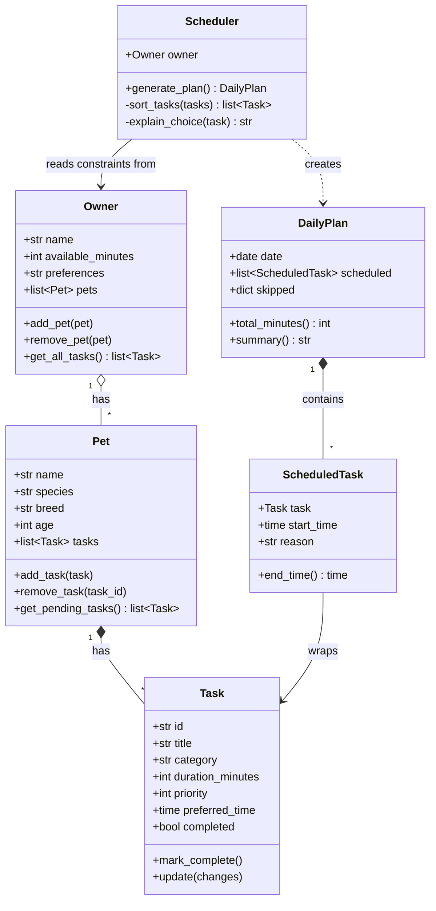

# PawPal+ Project Reflection

## 1. System Design

**a. Initial design**

- Identify three core actions a user should be able to perform (e.g., add a pet, schedule a walk, see today's tasks).

1. Enter owner and pet info. The user sets up a profile with the owner's name, the pet's name and species or breed, and any constraints, such as how much time they have available each day.

2. Add and edit care tasks. The user creates tasks like walks, feeding, meds, enrichment and grooming. Each task needs at least a duration and a priority, and the user can change or remove it later.

3. Generate and view a daily plan with an explanation. The app schedules the tasks within the owner's constraints, putting higher-priority tasks first and dropping them. It then shows the plan clearly and explains why it chose that order and what it left out.

- Briefly describe your initial UML design.
- What classes did you include, and what responsibilities did you assign to each?

Initial UML design: four classes. `Owner` holds the profile and daily constraints and owns the pets. `Pet` holds pet info and its tasks. `Task` holds one care activity (duration, priority). `Scheduler` takes an owner and builds a `DailyPlan`, which lists the scheduled tasks, the skipped tasks, and the reasoning for each decision.

**b. Design changes**

- Did your design change during implementation?
- If yes, describe at least one change and why you made it. 

---

## 2. Scheduling Logic and Tradeoffs

**a. Constraints and priorities**

- What constraints does your scheduler consider (for example: time, priority, preferences)?
- How did you decide which constraints mattered most?

**b. Tradeoffs**

- Describe one tradeoff your scheduler makes.
- Why is that tradeoff reasonable for this scenario?

---

## 3. AI Collaboration

**a. How you used AI**

- How did you use AI tools during this project (for example: design brainstorming, debugging, refactoring)?
- What kinds of prompts or questions were most helpful?

**b. Judgment and verification**

- Describe one moment where you did not accept an AI suggestion as-is.
- How did you evaluate or verify what the AI suggested?

---

## 4. Testing and Verification

**a. What you tested**

- What behaviors did you test?
- Why were these tests important?

**b. Confidence**

- How confident are you that your scheduler works correctly?
- What edge cases would you test next if you had more time?

---

## 5. Reflection

**a. What went well**

- What part of this project are you most satisfied with?

**b. What you would improve**

- If you had another iteration, what would you improve or redesign?

**c. Key takeaway**

- What is one important thing you learned about designing systems or working with AI on this project?
